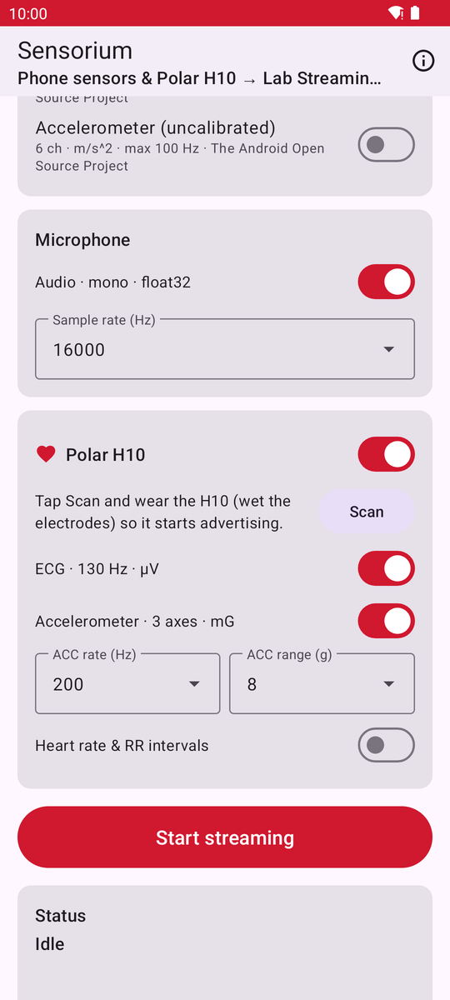
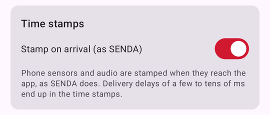
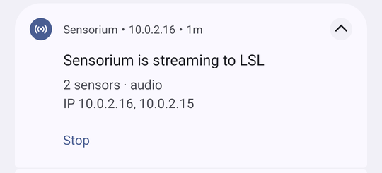

# Sensorium

**Sensorium** streams the sensors of an Android phone, its microphone and a **Polar H10** chest
strap to **[Lab Streaming Layer (LSL)](https://labstreaminglayer.org)**. Record the streams with
LabRecorder (or any other LSL consumer, such as OpenViBE) on a computer on the same network, or on
the phone itself with [RECORDA](https://github.com/NeuropsyOL/RECORDA).

<p align="center">
  
  &nbsp;
  
  &nbsp;
  
</p>

Sensorium 1.0 is a full rewrite of [SENDA](https://github.com/NeuropsyOL/SENDA) (SENsor DAta
streamer, [](https://doi.org/10.5281/zenodo.1419527)):
Kotlin, Material 3 with a light and a dark theme, a foreground service that keeps streaming with
the screen off, liblsl 1.17, and the Polar H10 support of
[PolarMobile](https://github.com/markspan/PolarMobile).

## What it streams

### Phone sensors

The phone's sensors are listed, with their channel count, unit, maximum rate and vendor
(left screenshot above). Switch on the ones you want, or use **All** / **None**.

- Accelerometer, gyroscope, magnetometer, gravity, linear acceleration, the rotation vectors,
  light, proximity, barometer, temperature, humidity, step counter/detector, heart rate, hinge
  angle, and the motion and off-body detectors. Vendor-specific sensors without a known layout
  are streamed with generic `ch1..chN` channels.
- **One sensor per type.** Many phones report a type more than once: a vendor and an Android
  (AOSP) version of gravity, linear acceleration or the rotation vectors, a wake-up copy, a
  second accelerometer in a foldable. Only the one Android uses by default is listed.
- **Not listed**: the uncalibrated and limited-axes variants of the accelerometer, gyroscope and
  magnetometer, the head tracker, 6-DOF pose and heading sensors, one-shot sensors (significant
  motion, wake gestures) and vendor-private types.
- **Only sensors that send data.** When the app starts, Sensorium listens to each sensor for up
  to 1.5 s (*Checking which sensors send data…*) and leaves out those that stay silent: phones
  sometimes report sensors without working hardware behind them, such as a hinge angle on a phone
  without a hinge. Sensors that only report when something happens (step detector, motion
  detectors) are always listed, as are heart rate and the step counter until their permission
  has been granted.
- One LSL outlet per sensor, named `<Sensor> <phone model>`, e.g. `Accelerometer Pixel 8`.
- Every channel has a label and a unit in the stream meta-data, and the stream type is
  meaningful (`Accelerometer`, `Gyroscope`, `Orientation`, `Light`, …).
- **Sensor rate**: 10, 25, 50, 100 or 200 Hz, or *Max* (the fastest the sensor allows). This
  applies to continuous sensors; on-change sensors (light, proximity, steps, …) stream at an
  irregular rate.
- Samples carry the sensor's own hardware time stamp, converted to the LSL clock (see
  [Time stamps](#time-stamps)).

### Microphone

Mono audio, float32, full scale ±1, at 8000, 16000, 22050, 44100 or 48000 Hz
(`Audio <phone model>`, type `Audio`). Samples are stamped with their capture time as the phone
reports it (see [Time stamps](#time-stamps)).

### GPS position

One sample per GPS fix on an irregular-rate stream `Location <phone model>` (type `Location`).
**GPS rate**: 0.1, 0.2, 0.5, 1 (the default), 2, 5 or 10 Hz. This is the rate asked of the GPS;
most phones deliver at most one fix per second whatever is asked, and fewer when reception is
poor, so the stream's time stamps, not its sample count, tell when each fix was taken.

| Channel | Unit | |
|---|---|---|
| Latitude, Longitude | degrees | WGS84 |
| Altitude | m | above the WGS84 ellipsoid (not sea level) |
| Accuracy | m | horizontal, 68% radius |
| Speed | m/s | |
| Bearing | degrees | direction of travel, clockwise from north |

Values the fix does not include are NaN (indoors there is often no fix at all). LSL samples
are 32-bit floats, which store latitude and longitude to within about 0.5 m: well below the few
metres a phone's GPS is accurate to. Each sample is stamped with the time of the fix, converted to
the LSL clock (on arrival with *Stamp on arrival*). It needs the precise location permission, and
location switched on in the phone's settings.

While it streams, a **GPS map** card shows the track (the last 3600 fixes), the latest position
and its accuracy circle on an interactive [OpenStreetMap](https://www.openstreetmap.org) map:
drag and pinch to move and zoom; **Follow** centres it on the latest fix again. The map tiles
are downloaded from the OpenStreetMap tile servers, so the map needs internet, and those servers
see which area you are looking at. The streamed data never leaves the LSL network.

### Polar H10

The ECG and accelerometer streams of PolarMobile and the
[PolarBLE](https://github.com/markspan/PolarBLE) desktop app, with the same names (middle
screenshot above):

| Stream | Name | Type | Rate | Unit |
|---|---|---|---|---|
| ECG | `<name>_ecg` | `ECG` | 130 Hz | µV |
| Accelerometer X/Y/Z | `<name>_acc` | `Accelerometer` | 25, 50, 100 or 200 Hz; range ±2, 4 or 8 g | mG |

`<name>` is the name the strap advertises, e.g. `Polar H10 A1B2C3D4`. When the Bluetooth
connection drops, Sensorium reconnects by itself; the LSL outlets stay up meanwhile, so the
recording continues. Bluetooth packets lost while connected are filled in with NaN (see
[Lost Bluetooth packets](#lost-bluetooth-packets-polar-h10)).

Heart rate and RR intervals are not streamed (Sensorium 1.1 and earlier had optional `<name>_hr`
and `<name>_rr` streams). Derive them from the ECG instead, with an R-peak detector such as
those in NeuroKit2, HeartPy or the ECG tools of MNE: that gives every beat with the ECG's 130 Hz
resolution and on the ECG's own time stamps, rather than the strap's on-board estimate stamped
on arrival.

## Time stamps

All streams are stamped on the phone's LSL clock (`lsl_local_clock()`). LabRecorder measures the
offset between that clock and its own and stores it in the XDF file, so after loading (pyxdf,
xdf-Matlab, MNE, EEGLAB) the phone's streams line up with each other and with streams from other
devices, such as EEG or stimulus markers.

Following the [LSL advice](https://labstreaminglayer.readthedocs.io/info/faqs.html), each sample is
stamped with the moment it was measured where the phone knows it, rather than the moment it reached
Sensorium:

| Stream | Time stamp | What remains |
|---|---|---|
| Phone sensors | The sensor's hardware time stamp, converted to the LSL clock | Nothing, apart from the sensor's own filtering delay |
| GPS position | The time of the fix (`Location.getElapsedRealtimeNanos`), converted to the LSL clock | The receiver's own processing; a fix more than 10 s from now is stamped on arrival instead |
| Microphone | The capture time the phone reports (`AudioRecord.getTimestamp`) for the last sample of each 20 ms block; earlier samples are spaced by the sample rate | Nothing, apart from analog/ADC delay. Without a reported capture time the block is stamped on arrival instead |
| Polar H10 | Arrival time on the phone of each Bluetooth packet, for its last sample; earlier samples are spaced by the sample rate. Samples of lost packets are filled with NaN (see below) | The H10's buffering and the Bluetooth transfer: a delay of some tens of ms that varies from packet to packet |

The H10 has its own clock, which LSL cannot synchronise with directly. The arrival times are
therefore passed on unsmoothed, as LSL recommends. The packet-to-packet jitter is removed when
loading the XDF file with dejittering on (the default in pyxdf, `dejitter_timestamps=True`), which
fits a straight line through the time stamps of each regular stream. The average Bluetooth delay
stays in the data; for analyses that need the H10 aligned to the millisecond, record a shared sync
event (for example a tap on the strap that also shows in the phone accelerometer).

### Lost Bluetooth packets (Polar H10)

The H10 sends its ECG and accelerometer in Bluetooth packets of some tens of samples (about
73 ECG samples, or 0.56 s). Now and then a packet does not arrive, for instance when the phone is
busy or the strap is far away or behind the body. Because every sample after the loss is stamped
back from the next packet's arrival time, the stream would then contain fewer samples than the
time it covers: sample numbers would no longer match time, and dejittering would spread the
missing half second over the surrounding samples.

Each packet also carries the H10's own clock time of its last sample. Sensorium compares that
with the previous packet: when more time has passed than the packet's samples cover, the
difference (rounded to whole samples) was lost, and Sensorium inserts that many samples of
**NaN** in front of the packet. The strap's actual sample rate can be slightly off the nominal
130 or 200 Hz, so Sensorium measures it on the H10's clock from packets that arrive back to back,
and counts the missing samples with that rate. The NaN samples are stamped like the others (back from the
packet's arrival at the nominal rate), so the stream keeps one sample per sample period and its
time stamps stay continuous. The H10 clock is used only to count the missing samples; the time
stamps are still the arrival times, passed on unsmoothed as described above.

- In the data, a lost packet shows as a run of NaN in every channel. Interpolate or mask it
  before filtering or R-peak detection; most filters spread a single NaN over the whole signal.
- The Status card counts the losses per stream, e.g. `ECG 52340 (146 lost in 2 gaps)`, and the
  live preview shows a break in the trace.
- A reconnect is not filled in: the time between disconnect and reconnect stays a gap in the
  time stamps, as before. A jump of the H10 clock of more than 10 s, or backwards, is not filled
  either and is reported in the Status card.
- Which recordings have this is in the stream meta-data: `<desc><acquisition><timestamps>` ends
  in `samples of lost packets are NaN`.

### Stamp on arrival (as SENDA)



The **Time stamps** card has a switch **Stamp on arrival (as SENDA)**. Off (the default) gives
the time stamps described above. On, phone sensors, the microphone and the GPS position are stamped the way
[SENDA](https://github.com/NeuropsyOL/SENDA) stamps them: with `lsl_local_clock()` at the moment
the data reaches the app. Use it to compare with, or continue, recordings made with SENDA;
otherwise leave it off. The Polar H10 is stamped on arrival in both settings.

<br clear="right">

What changes with the switch on:

| Stream | Time stamp | Effect on timing |
|---|---|---|
| Phone sensors | Moment Android delivers the event to the app | Every sample is late by the delivery delay: the sensor hub, Android's sensor service and thread scheduling. Usually a few ms, but it varies from event to event and can reach tens of ms when the phone is busy or events arrive in bursts; samples of one burst then get almost the same time stamp |
| Microphone | Moment each ~20 ms block is read, for its last sample; earlier samples spaced by the sample rate | Every block is late by the phone's audio input delay plus the read delay: on the emulator a median of 5 ms and up to about 110 ms, on phones often more |
| Polar H10 | Unchanged | Unchanged |

What that means for analysis:

- **Regular streams** (continuous sensors, microphone): dejittering when loading the XDF (the pyxdf
  default) removes the variation, but not the average delay. Everything from the phone then sits
  that average delay later than it happened, compared with streams from other devices such as EEG
  or markers. That delay differs per phone and per sensor and is not recorded anywhere.
- **Irregular streams** (light, proximity, steps and other on-change sensors) cannot be
  dejittered: each event keeps its own delivery delay.
- **Sample spacing**: without dejittering, the intervals between samples reflect delivery, not
  measurement, which distorts anything computed from them (velocities, derivatives, event timing
  within a stream).

Which setting a recording used is in each stream's meta-data, under
`<desc><acquisition><timestamps>`: `sensor hardware time stamp, converted to lsl_local_clock`,
`audio capture time (AudioRecord.getTimestamp), converted to lsl_local_clock`, or
`lsl_local_clock on arrival in the app`.

## Install

Download `Sensorium-<version>-release.apk` from the
[Releases](https://github.com/markspan/Senda-ci/releases) page (or, for the latest build, the
`Sensorium-apk` artifact of the *Android APK* workflow under Actions: a zip, unzip it first).
Copy it to the phone and open it (allow "install unknown apps"), or:

```bash
adb install -r Sensorium-1.3.0-release.apk
```

Requires Android 8.0 (API 26) or newer. Bluetooth LE is only needed for the Polar H10.

Sensorium has its own application id (`io.github.markspan.sensorium`), so it installs next to an
old SENDA instead of replacing it.

## Use

1. Switch on the phone sensors you want, and set the sensor rate.
2. Optionally switch on the **Microphone** and the **GPS position**, each with its rate.
3. For a Polar H10: moisten the electrodes and put the strap on (it only advertises while worn),
   switch on **Polar H10**, tap **Scan** and select the strap. Choose ECG and/or the
   accelerometer (with its rate and range).
4. Tap **Start streaming** and grant the permissions asked for.
5. On the recording computer, on the same Wi-Fi or LAN, open LabRecorder and press *Update*:
   the streams appear.

Your choices are remembered for next time.

### While streaming


The settings are locked while streaming. The top of the screen shows the phone's IP address (see
[KnownPeers](#when-the-computer-does-not-see-the-streams-knownpeers) below). Further down:

- **Status**: what is streaming and how many samples have been sent, and one line per LSL outlet.
  An open circle `○` turns into a filled `●` with *(consumer connected)* as soon as a
  recorder or viewer has opened that stream, so you can check on the phone that LabRecorder
  really receives it.
- **Signal**: a live plot of every streaming phone sensor, with its sample count and, for
  one-channel sensors, the latest value; and of the microphone and the H10 ECG and
  accelerometer. The newest sample is at the right edge. Phone sensor and ECG plots have a time
  axis, with the span they cover top right and a tick per second (per minute for the on-change
  sensors). Continuous sensors show their last 5 s; on-change sensors (light, proximity,
  steps, …) show their last 5 minutes against time, each value held until the next.
- The network interfaces LSL uses, and the Sensorium and liblsl versions.

Sensorium runs as a foreground service: it keeps streaming with the screen off or with another app
in front. The notification shows what is streaming and the IP address, and has a **Stop** button.

<br clear="right">

<p align="center">
  
</p>

### When the computer does not see the streams: KnownPeers

LSL finds streams through multicast, which many networks (eduroam, guest Wi-Fi, some corporate
networks) block. The computer can then ask the phone directly instead.

While streaming, Sensorium shows the phone's IP address in large type at the top of the screen,
with the matching `KnownPeers` line and a **Copy** button (right screenshot at the top). Put that
line in the `[lab]` section of the LSL configuration file on the recording computer:

```ini
[lab]
KnownPeers = {192.168.1.23}
```

and restart LabRecorder (or whichever LSL program records). liblsl reads the first of these that
exists:

| | File |
|---|---|
| 1 | The file named in the environment variable `LSLAPICFG` |
| 2 | `lsl_api.cfg` in the program's working directory (on Windows: next to LabRecorder) |
| 3 | `~/lsl_api/lsl_api.cfg` (per user) |
| 4 | `/etc/lsl_api/lsl_api.cfg` (system wide; on Windows `C:\etc\lsl_api\lsl_api.cfg`) |

Several devices are separated by commas, e.g. `{192.168.1.23, 192.168.1.40}`. Check the
addresses carefully: a single wrong entry is enough to stop discovery of that device.

### Networking notes

- The phone and the recording computer must be on the same network segment. A dedicated router,
  or the phone's own hotspot, works reliably; Sensorium also shows the hotspot address.
- A phone can get a different IP address when it reconnects to Wi-Fi. Reserve a fixed address for
  it in the router (DHCP reservation) so the `KnownPeers` entry stays valid.
- Android 12 and later limit sensors to 200 Hz unless an app holds `HIGH_SAMPLING_RATE_SENSORS`,
  which Sensorium does; some phones still cap lower. The rate the sensor allows is shown in the
  sensor list.
- For long recordings, exclude Sensorium from battery optimisation, especially on phones with
  aggressive power management.

## Build

Requirements: JDK 17, Android SDK 35, NDK 28.2.13676358 and CMake 3.31.6 (Android Studio installs
these on demand). liblsl 1.17.5 is downloaded and built by CMake.

```bash
./gradlew assembleDebug
```

- `-Pabis=arm64-v8a` builds for one ABI only, which is faster. The default is
  `arm64-v8a,armeabi-v7a,x86_64`.
- `liblsl.dir=<path>` in `local.properties` (or `-Pliblsl.dir=<path>`) builds against a local
  liblsl checkout instead of the download.
- `./gradlew test` runs the unit tests.

Release builds (`./gradlew assembleRelease`) are signed with the key given by
`SENSORIUM_KEYSTORE`, `SENSORIUM_KEYSTORE_PASSWORD`, `SENSORIUM_KEY_ALIAS` and
`SENSORIUM_KEY_PASSWORD`, as environment variables or as the `local.properties` keys
`sensorium.keystore`, `sensorium.keystore.password`, `sensorium.key.alias` and
`sensorium.key.password`. Without them the debug key is used.

The *Android APK* GitHub workflow runs the unit tests and builds the release APK on every push to `master` and on pull requests. In
CI the key comes from the repository secrets `SENSORIUM_KEYSTORE_BASE64`,
`SENSORIUM_KEYSTORE_PASSWORD`, `SENSORIUM_KEY_ALIAS` and `SENSORIUM_KEY_PASSWORD`. Pushing a `v*`
tag also attaches the APK to a GitHub release.

## Authors

- **Mark M. Span** ([markspan](https://github.com/markspan)): Sensorium, Polar H10 support
- **Ali Ayub Khan** ([AliAyub007](https://github.com/AliAyub007)): original SENDA, on which
  Sensorium is based

## License

GNU General Public License v3, see [LICENSE](LICENSE). liblsl is MIT licensed.

## Cite SENDA as

Ali Ayub Khan. (2018, October 24). AliAyub007/SENDA: New features added (Version 1.0.1). Zenodo.
http://doi.org/10.5281/zenodo.1469957
