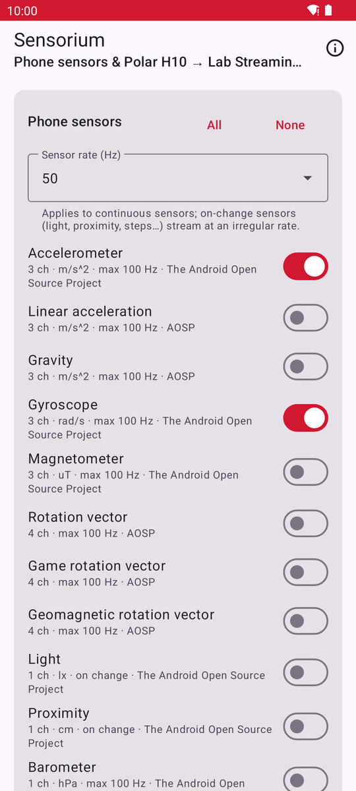
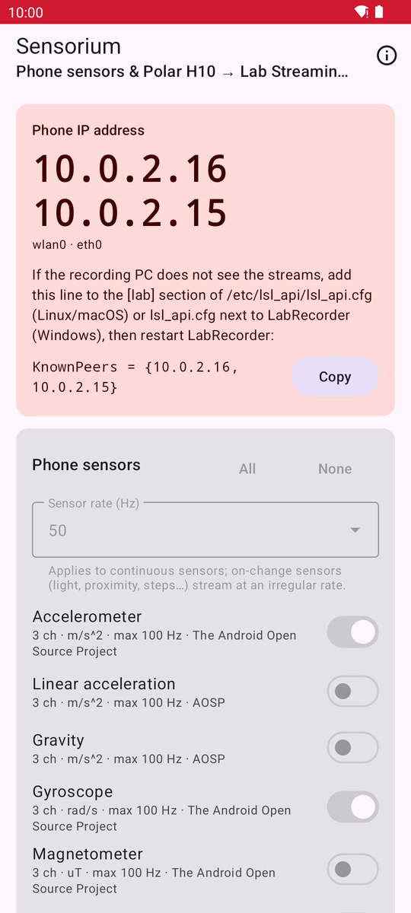
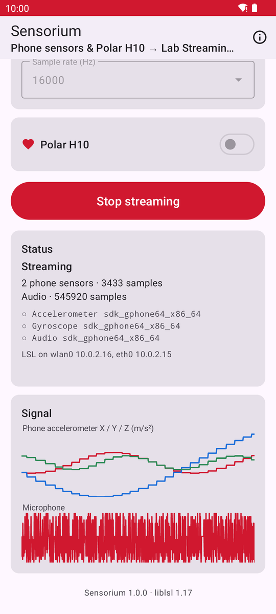

# Sensorium

**Sensorium** streams the sensors of an Android phone, its microphone and a **Polar H10** chest
strap to **[Lab Streaming Layer (LSL)](https://labstreaminglayer.org)**. Record the streams with
LabRecorder (or any other LSL consumer, such as OpenViBE) on a computer on the same network, or on
the phone itself with [RECORDA](https://github.com/NeuropsyOL/RECORDA).

<p align="center">
  
  &nbsp;
  
  &nbsp;
  
</p>

Sensorium 1.0 is a full rewrite of [SENDA](https://github.com/NeuropsyOL/SENDA) (SENsor DAta
streamer, [](https://doi.org/10.5281/zenodo.1419527)):
Kotlin, Material 3 with a light and a dark theme, a foreground service that keeps streaming with
the screen off, liblsl 1.17, and the Polar H10 support of
[PolarMobile](https://github.com/markspan/PolarMobile).

## What it streams

### Phone sensors

Every sensor the phone reports is listed, with its channel count, unit, maximum rate and vendor
(left screenshot above). Switch on the ones you want, or use **All** / **None**.

- Accelerometer, gyroscope, magnetometer, gravity, linear acceleration, the rotation vectors,
  light, proximity, barometer, temperature, humidity, step counter/detector, heart rate, hinge
  angle, head tracker, and the uncalibrated variants. Vendor-specific sensors without a known
  layout are streamed with generic `ch1..chN` channels.
- One LSL outlet per sensor, named `<Sensor> <phone model>`, e.g. `Accelerometer Pixel 8`.
- Every channel has a label and a unit in the stream meta-data, and the stream type is
  meaningful (`Accelerometer`, `Gyroscope`, `Orientation`, `Light`, …).
- **Sensor rate**: 10, 25, 50, 100 or 200 Hz, or *Max* (the fastest the sensor allows). This
  applies to continuous sensors; on-change sensors (light, proximity, steps, …) stream at an
  irregular rate.
- Samples carry the sensor's own hardware time stamp, converted to the LSL clock (see
  [Time stamps](#time-stamps)).

### Microphone

Mono audio, float32, full scale ±1, at 8000, 16000, 22050, 44100 or 48000 Hz
(`Audio <phone model>`, type `Audio`). Samples are stamped with their capture time as the phone
reports it (see [Time stamps](#time-stamps)).

### Polar H10

The same streams as PolarMobile and the [PolarBLE](https://github.com/markspan/PolarBLE) desktop
app (middle screenshot above):

| Stream | Name | Type | Rate | Unit |
|---|---|---|---|---|
| ECG | `<name>_ecg` | `ECG` | 130 Hz | µV |
| Accelerometer X/Y/Z | `<name>_acc` | `Accelerometer` | 25, 50, 100 or 200 Hz; range ±2, 4 or 8 g | mG |
| Heart rate (optional) | `<name>_hr` | `HeartRate` | irregular | bpm |
| RR intervals (optional) | `<name>_rr` | `RR` | irregular | ms |

`<name>` is the name the strap advertises, e.g. `Polar H10 A1B2C3D4`. When the Bluetooth
connection drops, Sensorium reconnects by itself; the LSL outlets stay up meanwhile, so the
recording continues.

## Time stamps

All streams are stamped on the phone's LSL clock (`lsl_local_clock()`). LabRecorder measures the
offset between that clock and its own and stores it in the XDF file, so after loading (pyxdf,
xdf-Matlab, MNE, EEGLAB) the phone's streams line up with each other and with streams from other
devices, such as EEG or stimulus markers.

Following the [LSL advice](https://labstreaminglayer.readthedocs.io/info/faqs.html), each sample is
stamped with the moment it was measured where the phone knows it, rather than the moment it reached
Sensorium:

| Stream | Time stamp | What remains |
|---|---|---|
| Phone sensors | The sensor's hardware time stamp, converted to the LSL clock | Nothing, apart from the sensor's own filtering delay |
| Microphone | The capture time the phone reports (`AudioRecord.getTimestamp`) for the last sample of each 20 ms block; earlier samples are spaced by the sample rate | Nothing, apart from analog/ADC delay. Without a reported capture time the block is stamped on arrival instead |
| Polar H10 | Arrival time on the phone of each Bluetooth packet, for its last sample; earlier samples are spaced by the sample rate | The H10's buffering and the Bluetooth transfer: a delay of some tens of ms that varies from packet to packet |

The H10 has its own clock, which LSL cannot synchronise with directly. The arrival times are
therefore passed on unsmoothed, as LSL recommends. The packet-to-packet jitter is removed when
loading the XDF file with dejittering on (the default in pyxdf, `dejitter_timestamps=True`), which
fits a straight line through the time stamps of each regular stream. The average Bluetooth delay
stays in the data; for analyses that need the H10 aligned to the millisecond, record a shared sync
event (for example a tap on the strap that also shows in the phone accelerometer).

## Install

Download `Sensorium-<version>-release.apk` from the
[Releases](https://github.com/markspan/Senda-ci/releases) page (or, for the latest build, the
`Sensorium-apk` artifact of the *Android APK* workflow under Actions: a zip, unzip it first).
Copy it to the phone and open it (allow "install unknown apps"), or:

```bash
adb install -r Sensorium-1.0.1-release.apk
```

Requires Android 8.0 (API 26) or newer. Bluetooth LE is only needed for the Polar H10.

Sensorium has its own application id (`io.github.markspan.sensorium`), so it installs next to an
old SENDA instead of replacing it.

## Use

1. Switch on the phone sensors you want, and set the sensor rate.
2. Optionally switch on the **Microphone** and pick a sample rate.
3. For a Polar H10: moisten the electrodes and put the strap on (it only advertises while worn),
   switch on **Polar H10**, tap **Scan** and select the strap. Choose ECG, accelerometer
   (with its rate and range) and, if you want them, heart rate and RR intervals.
4. Tap **Start streaming** and grant the permissions asked for.
5. On the recording computer, on the same Wi-Fi or LAN, open LabRecorder and press *Update*:
   the streams appear.

Your choices are remembered for next time.

### While streaming



The settings are locked while streaming. The top of the screen shows the phone's IP address (see
[KnownPeers](#when-the-computer-does-not-see-the-streams-knownpeers) below). Further down:

- **Status**: what is streaming and how many samples have been sent, and one line per LSL outlet.
  An open circle `○` turns into a filled `●` with *(consumer connected)* as soon as a
  recorder or viewer has opened that stream, so you can check on the phone that LabRecorder
  really receives it.
- **Signal**: a live preview of the phone accelerometer, the microphone and the H10 ECG and
  accelerometer, for whichever of those are streaming.
- The network interfaces LSL uses, and the Sensorium and liblsl versions.

Sensorium runs as a foreground service: it keeps streaming with the screen off or with another app
in front. The notification shows what is streaming and the IP address, and has a **Stop** button.

<br clear="right">

<p align="center">
  
</p>

### When the computer does not see the streams: KnownPeers

LSL finds streams through multicast, which many networks (eduroam, guest Wi-Fi, some corporate
networks) block. The computer can then ask the phone directly instead.

While streaming, Sensorium shows the phone's IP address in large type at the top of the screen,
with the matching `KnownPeers` line and a **Copy** button (right screenshot at the top). Put that
line in the `[lab]` section of the LSL configuration file on the recording computer:

```ini
[lab]
KnownPeers = {192.168.1.23}
```

and restart LabRecorder (or whichever LSL program records). liblsl reads the first of these that
exists:

| | File |
|---|---|
| 1 | The file named in the environment variable `LSLAPICFG` |
| 2 | `lsl_api.cfg` in the program's working directory (on Windows: next to LabRecorder) |
| 3 | `~/lsl_api/lsl_api.cfg` (per user) |
| 4 | `/etc/lsl_api/lsl_api.cfg` (system wide; on Windows `C:\etc\lsl_api\lsl_api.cfg`) |

Several devices are separated by commas, e.g. `{192.168.1.23, 192.168.1.40}`. Check the
addresses carefully: a single wrong entry is enough to stop discovery of that device.

### Networking notes

- The phone and the recording computer must be on the same network segment. A dedicated router,
  or the phone's own hotspot, works reliably; Sensorium also shows the hotspot address.
- A phone can get a different IP address when it reconnects to Wi-Fi. Reserve a fixed address for
  it in the router (DHCP reservation) so the `KnownPeers` entry stays valid.
- Android 12 and later limit sensors to 200 Hz unless an app holds `HIGH_SAMPLING_RATE_SENSORS`,
  which Sensorium does; some phones still cap lower. The rate the sensor allows is shown in the
  sensor list.
- For long recordings, exclude Sensorium from battery optimisation, especially on phones with
  aggressive power management.

## Build

Requirements: JDK 17, Android SDK 35, NDK 28.2.13676358 and CMake 3.31.6 (Android Studio installs
these on demand). liblsl 1.17.5 is downloaded and built by CMake.

```bash
./gradlew assembleDebug
```

- `-Pabis=arm64-v8a` builds for one ABI only, which is faster. The default is
  `arm64-v8a,armeabi-v7a,x86_64`.
- `liblsl.dir=<path>` in `local.properties` (or `-Pliblsl.dir=<path>`) builds against a local
  liblsl checkout instead of the download.
- `./gradlew test` runs the unit tests.

Release builds (`./gradlew assembleRelease`) are signed with the key given by
`SENSORIUM_KEYSTORE`, `SENSORIUM_KEYSTORE_PASSWORD`, `SENSORIUM_KEY_ALIAS` and
`SENSORIUM_KEY_PASSWORD`, as environment variables or as the `local.properties` keys
`sensorium.keystore`, `sensorium.keystore.password`, `sensorium.key.alias` and
`sensorium.key.password`. Without them the debug key is used.

The *Android APK* GitHub workflow runs the unit tests and builds the release APK on every push to `master` and on pull requests. In
CI the key comes from the repository secrets `SENSORIUM_KEYSTORE_BASE64`,
`SENSORIUM_KEYSTORE_PASSWORD`, `SENSORIUM_KEY_ALIAS` and `SENSORIUM_KEY_PASSWORD`. Pushing a `v*`
tag also attaches the APK to a GitHub release.

## Authors

- **Mark M. Span** ([markspan](https://github.com/markspan)): Sensorium, Polar H10 support
- **Ali Ayub Khan** ([AliAyub007](https://github.com/AliAyub007)): original SENDA, on which
  Sensorium is based

## License

GNU General Public License v3, see [LICENSE](LICENSE). liblsl is MIT licensed.

## Cite SENDA as

Ali Ayub Khan. (2018, October 24). AliAyub007/SENDA: New features added (Version 1.0.1). Zenodo.
http://doi.org/10.5281/zenodo.1469957
